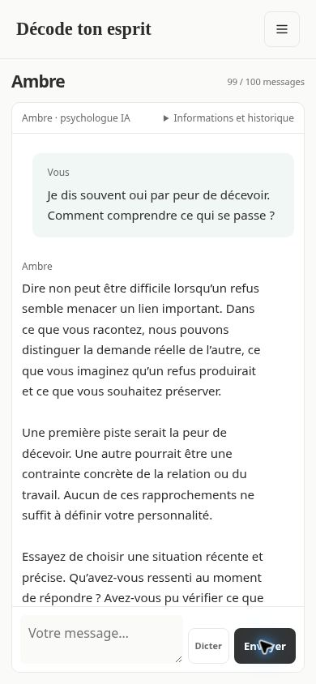

# Interface V10 — Ambre et cartographie

Statut : plan mis en œuvre après confirmation des contrats V10. Base examinée : `5eb09cf`. Le comportement Ambre est isolé dans `journal/src/chat-interface.mjs`, injecté par `ui.mjs` avec le module voix réel. La recette visuelle complète précède la publication.

## Intention et périmètre

L’envoi doit être compris dès le clic. La carte doit commencer par les pistes personnelles et permettre de comprendre ce qui les soutient, ce qui les nuance et ce qui peut être essayé. Garder l’identité claire et sobre du site : pas de nouvel écran de lancement, de décor, de jauges ou de catalogue en première lecture.

Périmètre : conversation Ambre, présentation de la cartographie, notes d’information des autres pages et alignement mobile des boutons d’ajout. Préserver routes, consentement spécifique Ambre, quotas, corrections, formulaires, brouillons, preuves exactes et protections contre les réponses tardives.

## Constats dans le code

- `sendChat` ajoute actuellement la bulle après le POST et conserve le texte envoyé dans le composeur. `busy(form,true)` participe au sentiment de blocage.
- L’attente est créée par `drawChat`, qui ne reconstruit pas le fil au départ du POST. Le premier état peut donc rester invisible.
- `drawChat` reconstruit la conversation et place systématiquement le défilement en bas. Une réponse longue commence au-dessus de la zone visible.
- La carte commence par les 16 domaines et le volume du catalogue. Elle ouvre plusieurs filtres avant d’expliquer une piste personnelle.
- Le détail possède déjà observations, fonctions possibles, contre-indices, contextes, citations et retours. Le problème principal est leur ordre et leur hiérarchie.
- Aucun contrat voix/capacités n’existe encore dans l’UI. Le test historique de conversation vide attend zéro message : il devra évoluer explicitement pour le nouvel accueil.

## Choix visuels

| Élément | Valeur proposée | Rôle |
| --- | --- | --- |
| Fond | `#FAFAF8` | Base actuelle, calme |
| Surface | `#FFFFFF` | Fil et fiche de compréhension |
| Texte | `#2D2D2D` | Titres, lecture, commandes |
| Texte secondaire | `#6B6B6B` | Métadonnées et notes |
| Vert | `#3D8577` | Focus, sélection, liens et action utile |
| Bleu gris | `#45657A` | Hypothèse, contexte et nuance |

Conserver la police système actuelle. Titres 22–28 px, corps 15–16 px, aides 12–13 px ; interligne de lecture 1,65 et largeur de texte de 65–75 caractères. Espacement sur une base de 4 px, marges utiles 12/16/24 px, cibles tactiles d’au moins 44 px. Pas de texte courant de carte à 9–11 px. Les états sont nommés et ne dépendent pas de la couleur.

Une seule évolution forte : la **fiche de compréhension**, organisée autour du vécu personnel. Tout le reste garde la structure familière du site. Les titres restent alignés à gauche ; seuls les boutons d’ajout demandés sont centrés sur mobile.

## Ambre : du clic à la réponse

| État | Ce que la personne voit | Règle |
| --- | --- | --- |
| Clic sur Envoyer | Sa bulle apparaît immédiatement, le composeur se vide | Avant tout `await`, avec une clé d’envoi stable |
| En cours | Bulle Ambre « Ambre réfléchit… », points discrets | Texte visible immédiatement, état accessible annoncé une fois |
| Pendant l’attente | Le composeur reste éditable pour préparer la suite | Un seul envoi actif ; bouton Envoyer indisponible tant que ce tour est actif |
| Réponse reçue | Le début de la réponse est visible, puis le texte apparaît progressivement | Aucun saut automatique vers sa fin |
| Échec ou envoi incertain | État lisible dans le tour concerné et action Réessayer | Même clé en cas de résultat réseau ambigu ; nouvelle clé après échec confirmé |

Séparer le texte déjà envoyé du nouveau brouillon. Un échec ne doit jamais remplacer ce qui a été saisi pendant l’attente. Garder la bulle et proposer la reprise depuis ce tour ; ne pas renvoyer automatiquement.

Maintenir le composeur et les nœuds du fil en place. Réconcilier les messages par identifiant de tour et clé client, sans ajouter deux bulles au même retour. Les gardes de navigation, de conversation et de version s’appliquent aussi aux animations et aux rappels différés.

Le protocole actuel livre une réponse terminée après polling. L’affichage progressif sera donc une révélation locale courte du texte reçu, par blocs lisibles, plafonnée à environ 1,5 seconde. Pas de faux pourcentage ni de faux flux fournisseur. Les liens de lecture et propositions apparaissent ensuite, sans déclencher une reconstruction du composeur. Avec mouvement réduit, afficher immédiatement toute la réponse.

### Défilement

À l’envoi, rendre visibles la nouvelle bulle et l’attente. À l’arrivée de la réponse, aligner son début dans le conteneur de conversation, une seule fois. Si la personne a remonté l’historique entre-temps, préserver sa position et proposer « Nouvelle réponse ». Aucun suivi automatique du bas pendant la révélation. À la réouverture d’une conversation, viser le début de la dernière réponse utile, sans rejouer son animation.

### Nouvelle conversation

Afficher uniquement la bulle `welcome` fournie par le backend : son texte tient compte des informations déjà renseignées et des capacités réelles. Elle appartient à la présentation de l’interface : aucun appel IA, quota, proposition ni faux tour enregistré. Elle apparaît uniquement dans un historique vide, y compris après effacement. Les restrictions d’accès et le consentement restent visibles et exacts. Le badge « Ambre · psychologue IA » reste présent.

### Contrat backend utilisé

Le POST fournit `request_id` ; les messages utilisateur et `pending_request` exposent `client_key`. Cette clé permet de récupérer un POST dont la réponse réseau a été perdue sans rapprocher arbitrairement deux textes identiques. `welcome` reste hors `messages`. Les propositions respectent `capabilities[kind].allowed` et peuvent expliquer une indisponibilité sans effacer leurs champs édités. Les routes et l’idempotence restent identiques.

## Dictée : comportement UI à raccorder

Prévoir un bouton microphone à côté du composeur, « Dicter », puis « Arrêter la dictée ». Pendant l’écoute : indicateur « Microphone actif » et transcription visible dans le champ, toujours modifiable. Arrêter la dictée ne doit jamais envoyer le message.

Le module `voice-input.mjs` fournit `VOICE_INPUT_SCRIPT` et `createVoiceInput({input,button,status,onChange,onState,maxLength,isCurrent})`, puis `stop()`, `dispose()`, `isActive()`. Il utilise la reconnaissance fr-FR du navigateur avec résultats intermédiaires ; aucun audio n’est envoyé au serveur du site. La note de confidentialité précise que le navigateur peut transmettre la voix à son service vocal et qu’aucun audio n’est conservé ici. Le traitement local n’est annoncé que lorsqu’il est réellement détecté par le module.

L’adaptateur UI doit conserver le texte existant, reconnaître les segments appartenant à la dictée et préserver toute correction manuelle. Une transcription tardive ne peut pas écraser un brouillon modifié ni apparaître après navigation. Arrêter/libérer l’écoute à l’envoi, au changement de page, à l’effacement et à la déconnexion. Refus de permission ou navigateur indisponible : message bref, saisie au clavier intacte. Annoncer l’état de dictée, pas chaque mot provisoire.

## Cartographie : les pistes personnelles d’abord

### Vue initiale

Titre « Ma cartographie », puis un compteur de **pistes personnelles**, sans « 160 repères » en titre. Une ligne d’aide maximum : « Chaque piste relie une hypothèse à vos éléments. » Afficher d’abord les pistes issues du portrait, leur observation courte et un statut lisible. Les domaines restent une information secondaire, pas une grille préalable de 16 entrées.

Recherche dans les pistes affichées. Ne plus basculer silencieusement vers le catalogue. Une action secondaire « Explorer les repères » ouvre le catalogue avec ses domaines, sous-domaines et recherche complète. Sans résultat personnel, proposer explicitement d’y poursuivre la recherche. Sans piste personnelle, conserver un état vide honnête ; le catalogue reste accessible, sans attribuer ses repères à la personne.

### Fiche de compréhension

Ordre de lecture et libellés proposés :

1. **Ce qui se dessine** : observation personnelle, avant la définition du concept. Titre courant du repère et statut distinct de son influence.
2. **Les éléments qui l’appuient** : sources nommées, mots d’origine consultables et citations strictement exactes. Ne pas confondre plusieurs extraits d’un même récit avec plusieurs preuves indépendantes.
3. **Dans quels contextes** : contextes déclarés et influence qualitative lorsqu’ils existent. Ne pas inventer une fréquence ni une intensité en l’absence de données.
4. **Ce que cela pourrait expliquer** : fonction possible formulée comme hypothèse.
5. **Ce qui invite à nuancer** : contre-indices existants, puis autres explications possibles. Une absence de contre-indice renseigné n’est pas une confirmation.
6. **Pour avancer** : une question ou un petit essai, puis les ressources. Une action discrète « Nuancer cette piste » conserve le formulaire actuel.

Définition, toutes les citations, lectures et mécanismes liés restent accessibles dans des sections secondaires identifiées. Éviter l’empilement de blocs colorés identiques et d’accordéons imbriqués. Afficher la provenance avec la piste correspondante ; aucune citation n’est réécrite ou personnalisée.

Conserver les quatre états métier ; tester des libellés plus directs : éléments concordants, à nuancer, à préciser, éléments contraires. Ils décrivent l’état d’une hypothèse. L’influence décrite reste un autre attribut. Aucun graphique de probabilité ni pourcentage.

### Desktop et mobile

Desktop : liste courte à gauche, une fiche sélectionnée à droite. Mobile : liste de pistes compactes puis ouverture d’une fiche avec retour clair « Mes pistes », qui restaure filtre et position. Éviter une liste déroulante interne de 260 px avant une longue fiche. Le catalogue est une vue secondaire dans la même page.

Conserver les nœuds des formulaires et leurs brouillons lors des mises à jour. Le polling ne remet ni la sélection, ni les sections ouvertes, ni le défilement à zéro. Garder les protections `source_version`/`analyzed_version` et une seule indication « Mise à jour en cours ».

## Informations sur les autres pages

Transformer les liens « Ambre peut… » en notes d’information compactes, sans lien, bouton, chevron ou état de survol. Exemple : « Ambre peut également aider à compléter ces informations. » Pour la synthèse : « Les échanges avec Ambre peuvent préciser cette synthèse. » Le lien de navigation Ambre reste le chemin explicite vers la conversation.

Sur mobile, centrer les commandes « Ajouter un proche » et « Ajouter un moment » avant ouverture de leur formulaire. Conserver les champs et les actions de sauvegarde alignés à gauche. Le formulaire ouvert et ses brouillons ne changent pas de comportement.

## Lots réalisés et validation

1. **Envoi et attente** : état local d’envoi, bulle immédiate, composeur libéré, réconciliation, erreurs, garde de navigation. Tests avant d’ajouter les animations.
2. **Réponse et accueil** : révélation courte, position de lecture, arrivée d’un nouveau message sans vol de défilement, accueil d’historique vide.
3. **Voix** : raccordement à l’adaptateur confirmé, transcription éditable et libération des ressources.
4. **Cartographie** : pistes personnelles par défaut, fiche réordonnée, catalogue secondaire, parcours mobile et maintien des corrections.
5. **Notes et mobile** : bulles d’information et centrage des commandes d’ajout.

Vérification : tests DOM avec POST différé, réseau incertain, double clic, réponse tardive, navigation et nouveau brouillon ; identifiant de tour unique ; défilement vers le début ; mouvement réduit ; premier accueil sans quota ; dictée simulée et édition concurrente ; carte vide/personnelle/catalogue ; citations exactes et contre-indices ; brouillons conservés au polling. Les tests de voix utilisent un adaptateur factice, sans microphone ni fournisseur réel.

## Recette navigateur réalisée

Compte synthétique, sans accès aux données de Romain : l’envoi apparaît avant la fin d’un POST volontairement retardé, le champ est vide et éditable pendant « Ambre réfléchit… », un brouillon suivant reste intact. À l’arrivée, le début de la réponse est visible, avec un seul message utilisateur. Les réponses terminées de l’historique ne se réaniment pas.

À 390 pixels de large, la cartographie montre ses deux pistes avant les filtres ; un appui ouvre la fiche et le retour conserve la navigation. Recherche et filtres ne prennent pas de place pour une petite liste personnelle ; ils restent disponibles dans l’exploration du catalogue ou une grande liste. Les notes d’Ambre sont informatives, et les boutons d’ajout de proche et de moment sont centrés. Une hauteur simulée de 450 pixels conserve le champ et les actions du chat dans l’écran. La déclaration `interactive-widget=resizes-content` aide les navigateurs compatibles à adapter le panneau au clavier.

La réduction de hauteur n’est pas un test de clavier physique. La dictée a été vérifiée avec des événements de reconnaissance simulés ; aucune mesure de qualité acoustique ou de compatibilité universelle n’est revendiquée.

Tests UI : 81 scénarios passent, dont les transitions V10 et l’intégration du véritable adaptateur voix avec un navigateur simulé. Les 9 tests propres au module voix passent également.

Recette visuelle par CUA : desktop, mobile 390 px, clavier virtuel, réponse longue, attente visible, personne ayant remonté le fil, parcours carte et formulaire d’ajout. Aucun changement de route, de quota ni de stockage psychologique requis par ce plan.

## Vérification du parti pris

Le plan retire les tuiles de domaines de la première lecture et le compte du catalogue : c’est le principal changement de hiérarchie demandé, pas une nouvelle décoration. Il conserve les surfaces claires, la typographie système, les formulaires et les mots du site. Chaque animation répond à une action ou indique une attente réelle ; chaque phrase visible doit aider à lire ou à décider.
